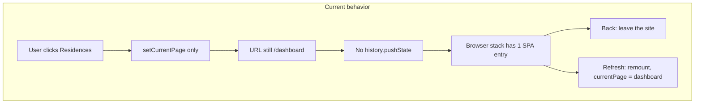

# Admin Dashboard: Browser Back, Forward, and Refresh

## Problem

On the admin dashboard:

| Browser control | Expected | Actual |
|---|---|---|
| **Back** | One step to the previous admin page | Leaves the dashboard (often the whole site) |
| **Forward** | One step to the next admin page | Does nothing useful, or follows leftover browser history |
| **Refresh** | Reload the current admin page | Lands on the dashboard home |

This is not a bug in the Back / Forward / Refresh buttons themselves. Those buttons work as the browser intends. The app never records admin page visits in the browser history, and it never restores the current page from the URL after a reload.

---

## How navigation works today

The admin UI is a **single-page app with no router**. There is no `react-router` (or equivalent) in `package.json`. `src/main.tsx` mounts one root component: `App`.

Admin screens are swapped by React state, not by URL.

```
Login → App.tsx sets isAdminPanel = true
     → AdminApp mounts
     → currentPage state chooses which list/form to render
     → browser URL stays /dashboard the whole time
```

### 1. Admin page is only in memory (`AdminApp.tsx`)

```240:240:src/components/admin/AdminApp.tsx
  const [currentPage, setCurrentPage] = useState<AdminPage>(() => 'dashboard');
```

Sidebar, dashboard cards, and nested jumps all call `handleNavigate` / `setCurrentPage`. That function **only updates React state**. It never calls `history.pushState`, never changes `window.location`, and never writes the page into session storage.

```301:331:src/components/admin/AdminApp.tsx
  const handleNavigate = (page: string) => {
    // ... RBAC checks ...
    setCurrentPage(page as AdminPage);
  };
```

After a user goes Dashboard → Residences → Units, the UI shows Units, but the address bar is still `/dashboard`. The browser has no idea Units was visited.

Nested context is also in-memory only, so it would be lost even if the page id were restored:

- `filteredResidenceId` (units for a residence)
- `documentFilterByUnit`
- `maintenanceFilterByResidenceId`
- Modal flags: `showUserForm`, `showResidenceForm`, `showUnitForm`, etc.

### 2. The public URL is only three auth paths (`App.tsx`)

```95:113:src/App.tsx
const PATH_LOGIN = '/login';
const PATH_SETUP = '/account-setup';
const PATH_DASHBOARD = '/dashboard';
const PATH_HOME = '/';

function resolveAuthUrl(...) {
  if (info.authStatus === 'checking') return null;
  if (info.isFirstLogin && !info.setupComplete) return PATH_SETUP;
  if (info.authStatus !== 'authenticated' || !info.isAuthenticated) return PATH_LOGIN;
  return info.isAdminPanel ? PATH_DASHBOARD : PATH_HOME;
}
```

There is no `/dashboard/users`, `/dashboard/residences`, `/dashboard/units`, etc.

When auth state changes, the app **replaces** the current history entry. It does not **push** a new one:

```130:132:src/App.tsx
  if (window.location.pathname !== nextPath) {
    window.history.replaceState(null, '', nextPath);
  }
```

Typical stack after login:

1. User opens the site (one history entry).
2. `replaceState` turns that entry into `/login`.
3. After login, `replaceState` turns the **same** entry into `/dashboard`.
4. Sidebar navigation does not add any further entries.

So the dashboard session is usually **one** browser history entry. Native Back therefore goes to whatever was before CasaZero (previous website, blank tab, or the host that opened the app). That matches “it takes me out of the dashboard completely.”

### 3. Native Back/Forward are not wired to in-app history

`App.tsx` does keep an in-memory stack (`history`, `historyIndex`, `handleBack`, `handleForward`). That stack is **only for the client/mobile screens** (`home`, `documents`, `chat`, …). It is driven by:

- AppBar back/forward buttons
- Alt+Left / Alt+Right (or Ctrl/Cmd + `[` / `]`)
- Swipe gestures

It is **not** connected to `window.popstate`. The browser’s own Back/Next buttons never call `handleBack` / `handleForward`.

When `isAdminPanel` is true, `AdminApp` is rendered instead of those client screens. The in-memory stack is unused. `src/NAVIGATION.md` documents that client-app system; it does not apply to the admin dashboard.

### 4. `popstate` only guards login vs dashboard

```534:557:src/App.tsx
  React.useEffect(() => {
    const onPopState = () => {
      // if logged-in admin landed on /login → replaceState back to /dashboard
      // if no session on /dashboard → send to /login and logout
    };
    window.addEventListener('popstate', onPopState);
    ...
  }, ...);
```

This listener does **not** restore `currentPage`. If Back ever hits `/login` while the session is still valid, it snaps the URL back to `/dashboard` without changing the admin view. If Back goes past the SPA, the user leaves the app.

### 5. Refresh always remounts on dashboard home

Browser Refresh (F5 / the toolbar button) reloads the document and remounts React from scratch.

What survives:

- Auth session in `localStorage` (`casazero_token`, `casazero_user`) via `src/utils/session.ts`
- After validation, `applyAuthenticatedSession` sets `isAdminPanel = true`

What does **not** survive:

- `currentPage` — always initialized to `'dashboard'`
- Filters, open forms, and list `refreshKey` counters
- Anything in the URL beyond `/dashboard`

On restore, login also forces the unused App-level admin page back to home:

```214:216:src/App.tsx
      if (isAdminDashboardRole(selectedRole)) {
        setIsAdminPanel(true);
        setAdminPage('dashboard');
```

`adminPage` in `App.tsx` is never passed into `AdminApp`. The real source of truth is `AdminApp`’s `currentPage`, which also defaults to `'dashboard'`. Refresh therefore always shows dashboard home, even though the user is still logged in.

---

## Why each button fails



### Back

1. Admin pages were never pushed onto `window.history`.
2. Login → dashboard used `replaceState`, so `/login` is not a separate step either.
3. The only remaining previous entry is outside the app.

### Next (Forward)

Forward only works if something was previously popped from the browser stack. Because admin visits were never pushed, there is nothing to go forward to inside the dashboard.

### Refresh

Reload destroys React state. The URL cannot tell the app which page to reopen, so the initializer `'dashboard'` wins.

---

## Where to improve

### Priority 1 — Put admin pages in the URL and in browser history

This single change fixes Back, Forward, and Refresh.

**New mapping** (example):

| `currentPage` | Suggested path |
|---|---|
| `dashboard` | `/dashboard` |
| `users` | `/dashboard/users` |
| `residence-list` / `residences` | `/dashboard/residences` |
| `units` | `/dashboard/units` |
| `construction-phases` | `/dashboard/construction-phases` |
| `document-list` | `/dashboard/documents` |
| `maintenance-list` | `/dashboard/maintenances` |
| `residence-wise-maintenances` | `/dashboard/residence-maintenances` |
| `support-list` | `/dashboard/support` |
| `company-list` | `/dashboard/companies` |
| `condominium-chat` | `/dashboard/chat` |
| `condominium-chat-{id}` | `/dashboard/chat/{id}` |
| `assign-residences` | `/dashboard/assign-residences` |
| `settings` | `/dashboard/settings` |

Filters should be query params, not only React state, for example:

- `/dashboard/units?residenceId=12`
- `/dashboard/documents?unitId=4&residenceId=12`
- `/dashboard/maintenances?residenceId=12`

**Files to change**

| File | Change |
|---|---|
| `src/components/admin/AdminApp.tsx` | Initialize `currentPage` (and filters) from `location.pathname` / search. On `handleNavigate` and nested jumps (`handleViewUnitsForResidence`, `handleViewDocumentsForUnit`, `handleViewMaintenanceForResidence`), `pushState` the matching path. Listen to `popstate` and set `currentPage` from the URL. |
| `src/App.tsx` | Stop treating every authenticated admin URL as a single `/dashboard` blob. `replaceUrlToMatchAuth` should only force `/login` or `/account-setup` vs “any `/dashboard…` path”. Do not `replaceState` a deep link like `/dashboard/users` down to `/dashboard`. |
| New helper, e.g. `src/utils/adminRoutes.ts` | Bidirectional map: page id + filters ↔ path + query. Keep RBAC checks in one place. |

**Two implementation options**

1. **Recommended:** add `react-router-dom` and replace `currentPage` with routes. Back/Forward/Refresh and bookmarks then work by default.
2. **Smaller change:** keep `currentPage`, but sync it with `history.pushState` / `popstate`. Same idea, more manual.

Auth transitions can keep `replaceState` (`/login` → `/dashboard`) so Back from the **first** dashboard screen does not return to the login form. After that, **each sidebar/page change must `pushState`**, not `replaceState`.

### Priority 2 — Restore the page on boot / refresh

On mount (after session validation):

1. Read pathname (and query).
2. If it maps to a known admin page and the role may open it, set `currentPage` to that page.
3. If the path is unknown or forbidden, fall back to `/dashboard` (existing `ProtectedRoute` / `useLayoutEffect` RBAC already redirects condo admins away from super-admin pages).

Do **not** reset to dashboard in `applyAuthenticatedSession` when the URL already points at a valid admin page.

Hosting must serve `index.html` for all `/dashboard/*` paths (Vite does this in dev; production needs the same SPA fallback). Refreshing `/dashboard/users` without that rewrite returns 404.

### Priority 3 — Align `popstate` with page state

Today `onPopState` only fixes login/dashboard mismatches. After URL routing exists it should:

- If the user is logged in and the path is an admin page → set `currentPage` (or let the router render it).
- If the user is logged in and the path is `/login` → `replaceState` back to the last dashboard URL (keep this guard).
- If there is no session and the path is under `/dashboard` → logout and `/login` (keep this guard).

Avoid fighting the router: do not `replaceState` to bare `/dashboard` while the user is backing through `/dashboard/units` → `/dashboard/residences`.

### Priority 4 — Clean up unused / misleading navigation code

- `adminPage` / `setAdminPage` in `App.tsx` is never passed to `AdminApp`. Either remove it or make `AdminApp` take the URL as the source of truth.
- Client-app `history` / `historyIndex` in `App.tsx` does not help the admin dashboard. Do not reuse it for admin pages; use real browser history instead.
- Update `src/NAVIGATION.md` so it is clear that document describes the **client** AppBar, not native browser buttons on the **admin** panel.

### Optional later

- Open create/edit forms as routes or query flags (`?edit=123`) if Back should close a form instead of leaving the list.
- `sessionStorage` last-page fallback if you must support hosts that cannot rewrite `/dashboard/*` yet. This is a weaker substitute: it helps Refresh, not Back/Forward, and breaks with multiple tabs.

---

## Suggested implementation order

1. Add page ↔ path mapping (`adminRoutes.ts`).
2. `pushState` on every `handleNavigate` / nested jump; initialize state from the URL on mount.
3. Narrow `replaceUrlToMatchAuth` so it does not wipe deep links.
4. Teach `popstate` (or React Router) to update `currentPage`.
5. Persist filters in the query string.
6. Confirm production SPA fallback for `/dashboard/*`.
7. Remove or stop resetting unused `adminPage` state.

After that:

- **Back** = previous admin page (then leave the site only from dashboard home).
- **Forward** = next admin page in the same visit.
- **Refresh** = same admin page, same filters, still logged in.

---

## Quick reference

| Symptom | Root cause | Fix location |
|---|---|---|
| Back leaves the dashboard | Admin visits never `pushState`; login uses `replaceState`; usually one history entry | `AdminApp.handleNavigate`, `App.replaceUrlToMatchAuth` |
| Forward does nothing | Nothing was pushed, so nothing was popped | Same as Back |
| Refresh opens dashboard home | `currentPage` defaults to `'dashboard'`; URL has no page; session restore also sets dashboard | `AdminApp` initial state, `App.applyAuthenticatedSession`, URL mapping |
| Filters lost on refresh | Residence/unit filters are React state only | Query params on nested navigations in `AdminApp.tsx` |
| Existing Back/Forward in AppBar | Client-app only; not native browser buttons; unused while admin panel is open | `App.tsx` + `src/NAVIGATION.md` — do not treat as the admin fix |
