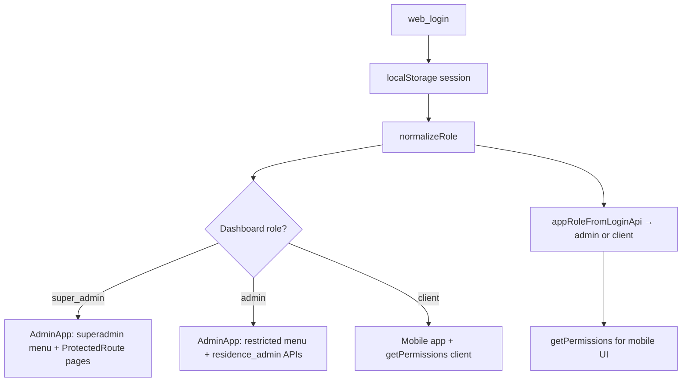

# CasaZero Admin Dashboard

A React + TypeScript web application for **smart-home / condominium management**. It combines a **mobile-first resident experience** and a **desktop admin dashboard**, backed by a Laravel API and Firebase (chat).

**Company:** Furlan Costruzioni · **Version:** 0.1.0 · **API:** `https://backend.casazero.site/api`

---

## Table of contents

1. [What this project does](#what-this-project-does)
2. [Tech stack](#tech-stack)
3. [Project structure](#project-structure)
4. [Application architecture](#application-architecture)
5. [Authentication & session](#authentication--session)
6. [Role-based access control (RBAC)](#role-based-access-control-rbac)
7. [Admin dashboard modules](#admin-dashboard-modules)
8. [Mobile / resident app screens](#mobile--resident-app-screens)
9. [API integration](#api-integration)
10. [Internationalization](#internationalization)
11. [How to add new features](#how-to-add-new-features)
12. [Development](#development)
13. [Known limitations & risks](#known-limitations--risks)
14. [Further documentation](#further-documentation)

---

## What this project does

| Surface | Audience | Purpose |
|--------|----------|---------|
| **Resident app** | `client` (resident) | Documents, maintenance (N1/N2/N3), tickets, AI, chat, smart home, profile |
| **Admin dashboard** | `admin` (condominium) + `super_admin` (platform) | CRUD for users, residences, units, documents, maintenance, support, companies, chat |

Both surfaces share one login (`POST /user/web_login`), one token, and one `App.tsx` router. After login, **admins and super admins** land on `/dashboard`; **residents** land on the mobile home at `/`.

---

## Tech stack

| Layer | Choice |
|-------|--------|
| UI | React 18, TypeScript, Vite 6 |
| Styling | Tailwind CSS, design tokens in `src/styles/globals.css` |
| Components | Radix UI + shadcn-style `src/components/ui/` (~49 files) |
| Motion | `motion` (Framer Motion) |
| Forms | React Hook Form |
| Charts | Recharts |
| Toasts | Sonner |
| Chat backend | Firebase (custom token from login) |
| HTTP | Native `fetch` (no React Query / Axios) |

**Scripts:** `npm run dev` (port 3000) · `npm run build` → `build/`

---

## Project structure

```
CasaZero-AdminDashboard/
├── index.html
├── package.json
├── vite.config.ts              # Aliases, chunks, dev console forwarder
├── README.md                   # This file
├── PROJECT-ANALYSIS.md         # Older deep-dive (partially outdated API URL)
├── RBAC_FIX_REPORT.md          # Recent session/RBAC stabilization notes
└── src/
    ├── main.tsx                # Entry → App.tsx
    ├── App.tsx                 # Auth gate, mobile router, admin panel toggle
    ├── index.css
    ├── assets/                 # Logos / Figma-exported images
    ├── styles/globals.css      # Design tokens
    ├── utils/
    │   ├── session.ts          # localStorage session + normalizeRole()
    │   ├── rbac.ts             # Dashboard superadmin vs condominium admin
    │   ├── permissions.ts      # Mobile app client vs admin matrix
    │   ├── api.ts              # API_BASE, fetch helpers, date formatting
    │   ├── LanguageContext.tsx # IT/EN i18n (~1400+ lines)
    │   ├── chatDisplay.js
    │   └── chatAccess.js
    ├── hooks/                  # Chat, Firebase auth, residences
    ├── firebase/               # firebase.js, firebaseAuth.js, chat services
    ├── components/
    │   ├── admin/              # Dashboard (34+ files) — see below
    │   ├── casazero/           # Mobile chrome (AppBar, BottomNav, cards…)
    │   ├── screens/            # 16 full-screen views
    │   └── ui/                 # Shared primitives
    ├── ShowcaseScreens.tsx     # Dev/style showcase
    └── *.md                    # Role guides, navigation, changelogs
```

### Admin components (`src/components/admin/`)

| File / area | Responsibility |
|-------------|----------------|
| `AdminApp.tsx` | Page router, user/residence/unit/document/maintenance CRUD API calls |
| `AdminLayout.tsx`, `AdminSidebar.tsx`, `AdminHeader.tsx` | Shell + RBAC-aware menu |
| `ProtectedRoute.tsx` | Superadmin-only page guard |
| `UserList.tsx`, `UserForm.tsx` | User management |
| `ResidenceList.tsx`, `ResidenceForm.tsx` | Buildings / residences |
| `UnitManagementList.tsx`, `UnitForm.tsx` | Units per residence |
| `DocumentList.tsx`, `DocumentForm.tsx` | Document catalog |
| `MaintenanceList.tsx`, `MaintenanceForm.tsx` | Maintenance programs (very large form) |
| `SupportList.tsx`, `SupportForm.tsx` | Support tickets |
| `CompanyList.tsx`, `CompanyForm.tsx` | Company management |
| `AssignResidences.tsx` | Tag users to units |
| `ConstructionPhasesList.tsx` | Construction phases |
| `CondominiumChat.tsx`, `CondominiumChatPage.tsx` | Admin chat UI |

---

## Application architecture

```
main.tsx
   └── App.tsx (LanguageProvider)
         ├── Not authenticated → AuthScreen
         ├── First login (password set by admin) → FirstLoginSetupScreen
         ├── isAdminPanel → AdminApp (full dashboard)
         └── Else → Mobile shell
               ├── AppBar + screen switch + BottomNav
               ├── getPermissions(role) for screen gates
               └── Floating button → toggle AdminApp (if role === 'admin')
```

**State:** Almost everything lives in `App.tsx` / `AdminApp.tsx` via `useState` — no Redux/Zustand. Session is persisted in `localStorage` and re-read on refresh.

**URLs (cosmetic, not React Router):**

| Path | Meaning |
|------|---------|
| `/login` | Logged out |
| `/account-setup` | First-login password setup |
| `/dashboard` | Admin dashboard session |
| `/` | Resident mobile app |

---

## Authentication & session

### Login flow

1. `AuthScreen` → `POST ${API_BASE}/user/web_login` with email/password.
2. Response provides `token`, `user` (incl. `role`, `firebase_token`, `is_password_set_by_admin`).
3. `setSession({ token, user })` writes:
   - `casazero_token`
   - `casazero_user` (JSON)
   - `casazero_role` (normalized)
4. Firebase: `loginWithFirebaseToken` for chat.
5. If `is_password_set_by_admin` and setup flag missing → `FirstLoginSetupScreen`; else main app.

### Session helpers (`src/utils/session.ts`)

- `normalizeRole(raw)` → `'client' | 'admin' | 'super_admin'`
- `clearSession()` on logout / before new login (scoped keys only — no `localStorage.clear()`)
- `clearFirstLoginFlags()` removes `casazero_setup_*` keys

### Important behavior

- **Shared across tabs:** `localStorage` is per-origin, not per tab. Two different accounts in two tabs will converge to whoever logged in last. See `RBAC_FIX_REPORT.md` §9.
- **Dev-only:** `DemoControls` can switch mobile `client`/`admin` only when `import.meta.env.DEV`.

---

## Role-based access control (RBAC)

The app uses **two related but separate** permission layers. When adding features, decide which layer applies.

### Layer 1 — Mobile app (`src/utils/permissions.ts`)

**Roles in UI state:** `'client' | 'admin'` only (`App.tsx` `Role` type).

- API may return `super_admin`, but `appRoleFromLoginApi()` maps both `admin` and `super_admin` → **`admin`** for the mobile shell.
- `getPermissions(role)` returns ~40 boolean flags (screens, documents, maintenance, tickets, chat, etc.).
- Used by: `BottomNav`, `HomeScreen` tiles, `TicketsScreen`, `ChatScreen`, conditional screens in `App.tsx`.

**Gap:** There is no distinct `super-admin` branch in `permissions.ts` (docs mention `super-admin` in labels but the switch only handles `client` and `admin`).

### Layer 2 — Admin dashboard (`src/utils/rbac.ts`)

**Roles:** `superadmin` vs `admin` (condominium administrator).

| Function | Purpose |
|----------|---------|
| `normalizeRbacRole(raw)` | Maps API strings via `normalizeRole()` → `superadmin` / `admin` / `unknown` |
| `isSuperAdmin(user)` | Full platform access |
| `isAdmin(user)` | Condominium tier (not superadmin) |
| `getSafeRole(user)` | Unknown roles fail-closed to **`admin`** (restricted), never superadmin |
| `canCondominiumAdminAccessPage(page)` | Allow-list for condo admins |
| `SUPERADMIN_ONLY_ADMIN_PAGES` | Deny-list pages for condo admins |
| `ProtectedRoute` | Renders children only if `getSafeRole === 'superadmin'` |

### Canonical role normalization (`session.ts`)

```
superadmin, super_admin, superadministrator → super_admin
admin, administrator                        → admin
(other)                                     → client
```

### Admin sidebar & pages

**Super admin menu:** Dashboard, residences (+ construction phases), documents, maintenance, support tickets, condominium chat (per residence), companies, users.

**Condominium admin menu (restricted):** Residences (list + units), maintenance list, condominium chat — **no** dashboard, users, documents list, assign-residences, companies, analytics, etc.

**Guards:**

- `AdminSidebar` — `isSuperAdmin(sessionUser)` picks menu set.
- `AdminApp.handleNavigate` — blocks illegal pages for condo admins.
- `useLayoutEffect` — redirects condo admin off superadmin URLs to `residence-list`.
- `renderContent` — wraps superadmin pages in `<ProtectedRoute>`.
- **Feature flags in lists:** e.g. `MaintenanceList` — **Create** only if `isSuperAdmin`; `ResidenceList` / `UnitManagementList` — add buttons superadmin-only.

### Data scoping (API, not just UI)

- `fetchResidencesCatalog` / `fetchUnitListCatalog` send `residence_admin: <logged-in user id>` from `getSessionResidenceAdminId()`.
- Chat residences: `useChatResidences` passes superadmin flag to API.
- **Backend must enforce** the same scopes; UI hiding is not security.

### RBAC diagram



---

## Admin dashboard modules

| Page ID | Super admin | Condo admin | Main component |
|---------|:-----------:|:-----------:|----------------|
| `dashboard` | ✅ | ❌ | `AdminDashboard` |
| `users` | ✅ | ❌ | `UserList` / `UserForm` |
| `residence-list`, `residences` | ✅ view | ✅ view | `ResidenceList` |
| `units` | ✅ view | ✅ view | `UnitManagementList` |
| `construction-phases` | ✅ | ❌ | `ConstructionPhasesList` |
| `assign-residences` | ✅ | ❌ | `AssignResidences` |
| `document-list` | ✅ | ❌ | `DocumentList` |
| `maintenance-list` | ✅ | ✅ | `MaintenanceList` |
| `support-list` | ✅ | ❌ | `SupportList` |
| `company-list` | ✅ | ❌ | `CompanyList` |
| `condominium-chat-*` | ✅ | ✅ (scoped residences) | `CondominiumChatPage` |
| `settings` | ✅ (placeholder) | ❌ | Static placeholder |

`AdminApp.tsx` also centralizes **user create/update** (`POST /user/create`, `POST /user/update`) with role mapping (`client` → `resident` for API).

---

## Mobile / resident app screens

| Screen | File | Notes |
|--------|------|-------|
| Home | `HomeScreen.tsx` | Completed vs under-construction; permission-gated tiles |
| Documents | `DocumentsScreen.tsx` | Categories, search; role affects actions |
| Maintenance | `MaintenanceScreen.tsx` | N1 / N2 / N3 priorities |
| AI | `AIScreen.tsx` | Assistant |
| Hub | `HubScreen.tsx` | Ecosystem entry |
| Tickets | `TicketsScreen.tsx` | Support |
| Chat | `ChatScreen.tsx` | Group chat + announcements |
| Smart home | `SmartHomeScreen.tsx` | Devices |
| Profile | `ProfileScreen.tsx` | Settings, logout, language |
| Notifications | `NotificationsScreen.tsx` | |
| Analytics / Users / Buildings | Admin-oriented screens gated by `permissions` |

**Navigation:** In-app history stack (back/forward, keyboard shortcuts, swipe) — not React Router.

---

## API integration

**Single base:** `src/utils/api.ts`

```ts
export const API_BASE = 'https://backend.casazero.site/api';
export const API_ORIGIN = 'https://backend.casazero.site';
```

**Patterns:**

- Bearer token: `Authorization: Bearer ${casazero_token}`
- Prefer `safeJsonParse()` for responses
- Prefer `fetchResidencesCatalog()` / `buildResidencesCatalogRequestBody()` for scoped lists
- Many admin components still call `fetch` directly with duplicated headers

**Representative endpoints:**

| Area | Methods |
|------|---------|
| Auth | `POST /user/web_login` |
| Users | `POST /user/get`, `POST /user/create`, `POST /user/update`, `DELETE /user/delete/:id`, `GET /single/user/:id` |
| Residences | `POST /residences`, create/update/delete residence |
| Units | `POST /unit_list`, `POST /unit_by_residence`, `POST /unit_delete` |
| Documents | `POST /documents`, `POST /web_unit_wise_documents`, categories/types |
| Maintenance | `POST /maintenance/store`, update, item CRUD, categories, priorities |
| Support | `POST /all-support-tickets`, issue types, delete |
| Companies | `GET/POST /get_all/company`, create/update/delete |
| Assignments | `POST /tag_user_to_unit/create`, `POST /remove_user_from_unit` |

> **Note:** `PROJECT-ANALYSIS.md` references an older host (`smarthome.attoexasolutions.com`). Trust `api.ts` as source of truth.

---

## Internationalization

- `LanguageProvider` in `src/utils/LanguageContext.tsx`
- Languages: **Italian** (default), **English**
- Use `const { t, language, setLanguage } = useLanguage()` in components
- Add keys in the context file for new UI strings (admin + mobile)

---

## How to add new features

### A. New admin dashboard page (superadmin only)

1. Add page id to `AdminPage` type in `AdminApp.tsx`.
2. Add to `SUPERADMIN_ONLY_ADMIN_PAGES` in `rbac.ts` if condo admins must not access it.
3. Add menu item in `AdminSidebar.tsx` inside the `full` menu array.
4. Add `case` in `AdminApp.renderContent()` wrapped with `superadminOnly(...)`.
5. Create list/form components under `src/components/admin/`.
6. Add API calls via `API_BASE` + `safeJsonParse`; reuse session token pattern from `api.ts`.
7. Add translation keys in `LanguageContext.tsx`.

### B. New admin page (condo admin + superadmin)

1. Allow page in `canCondominiumAdminAccessPage()`.
2. Add to **both** `restricted` and `full` menus in `AdminSidebar.tsx` (or shared submenu).
3. Do **not** wrap in `ProtectedRoute` unless only superadmin should see it.
4. Scope API calls with `residence_admin` / user `residences` array.

### C. New mobile screen

1. Extend `Screen` type and `history` handling in `App.tsx`.
2. Add screen component under `src/components/screens/`.
3. Extend `Permissions` + `getPermissions()` in `permissions.ts`.
4. Gate in `App.tsx` with `permissions.canAccess…`.
5. Optionally add tab in `BottomNav.tsx` if primary navigation.

### D. New permission-sensitive button

- **Mobile:** `hasPermission(role, 'canX')` or `permissions.canX`.
- **Admin:** `isSuperAdmin(sessionUser)` or `getSafeRole(sessionUser)`.
- Always mirror checks on the **backend** for the same action.

### E. New API module (recommended refactor)

Extract repeated fetch logic into `src/services/<feature>Api.ts` using helpers from `api.ts` — reduces duplication across 15+ admin files.

### Code health priorities (from analysis)

| Priority | Item |
|----------|------|
| High | Split `MaintenanceForm.tsx` (~2800 lines) into submodules |
| High | Environment variable for `API_BASE` (`import.meta.env.VITE_API_BASE`) |
| Medium | React Router for real URLs and deep links |
| Medium | Central API service layer + React Query for cache/loading |
| Medium | Align `permissions.ts` with three-tier roles if mobile super-admin differs from admin |
| Low | Vitest tests for `normalizeRole`, `canCondominiumAdminAccessPage`, `getPermissions` |
| Low | Error boundaries around `AdminApp` and mobile shell |

---

## Development

```bash
npm install
npm run dev    # http://localhost:3000
npm run build  # output: build/
```

**Vite aliases:** `@` → `src/`, versioned package aliases, `figma:asset/...` → `src/assets/`.

**Dev tools:** Console forwarder plugin logs browser `console` to the terminal; `DemoControls` for role/residence status (dev only).

---

## Known limitations & risks

1. **UI RBAC ≠ security** — Token + server policies must enforce access.
2. **Multi-tab same browser** — One shared session; last login wins.
3. **Dual RBAC models** — Mobile `client|admin` vs dashboard `superadmin|admin`; map carefully when using API `role` strings.
4. **Unknown API roles** — `getSafeRole()` treats unknown as condominium `admin` (restricted), not superadmin.
5. **Large components** — Hard to test and review; prefer incremental extraction.
6. **No automated tests** in repo today.
7. **Hardcoded credentials in `AuthScreen.tsx` defaults** — Remove or gate for production builds.

---

## Further documentation

| File | Topic |
|------|--------|
| `src/README-CASAZERO.md` | Mobile product overview |
| `src/ROLE-PERMISSIONS.md` | Permission matrix (3 roles, conceptual) |
| `src/ROLE-FEATURES-GUIDE.md` | Role feature breakdown |
| `src/NAVIGATION.md` | History / gestures |
| `src/LANGUAGE-AND-FIRST-LOGIN.md` | i18n + onboarding |
| `src/CHANGELOG-RBAC.md` | RBAC history |
| `RBAC_FIX_REPORT.md` | Session isolation fixes (2025) |
| `PROJECT-ANALYSIS.md` | Extended architecture notes (verify API URL) |

---

## Quick reference: which file to touch

| Goal | Start here |
|------|------------|
| Login / logout | `AuthScreen.tsx`, `App.tsx`, `session.ts` |
| Who sees admin menu | `rbac.ts`, `AdminSidebar.tsx` |
| Who sees mobile tabs | `permissions.ts`, `BottomNav.tsx` |
| New API URL / headers | `api.ts` |
| User CRUD payloads | `AdminApp.tsx`, `UserForm.tsx`, `userFormRoleUtils.ts` |
| Chat | `firebase/`, `hooks/useFirestoreResidenceChat.js`, `CondominiumChatPage.tsx` |
| Translations | `LanguageContext.tsx` |

---

*Analysis updated: June 2025 — reflects current codebase including `session.ts`, `rbac.ts`, and `backend.casazero.site` API.*
